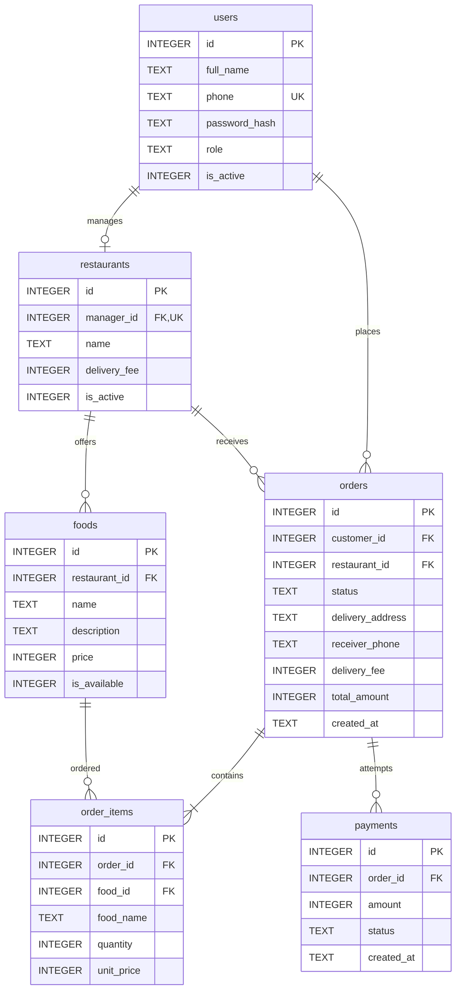

<div dir="rtl" align="right">

# دیتابیس ساده سامانه سفارش غذا

این طراحی برای نسخه متوسط دانشجویی پروژه تهیه شده است. دیتابیس شش جدول دارد و با SQLite اجرا می‌شود. فایل آماده شامل ساختار و داده‌های آزمایشی است؛ فایل‌های SQL نیز ساخت مجدد آن را ممکن می‌کنند.

## ابزار و روش اجرا

ابزار پیشنهادی [DB Browser for SQLite](https://sqlitebrowser.org/) است. نسخه‌ای استفاده کنید که SQLite 3.37 یا جدیدتر دارد؛ با دستور `SELECT sqlite_version();` می‌توانید نسخه موتور را ببینید. واژه STRICT در پایان تعریف جدول‌ها فقط کمک می‌کند نوع داده ستون‌ها رعایت شود.

برای استفاده از فایل آماده:

1. بسته را استخراج کنید و DB Browser for SQLite را باز کنید.
2. با Open Database فایل `food_order.db` را باز کنید.
3. در Browse Data جدول‌ها و داده‌ها را ببینید.
4. در Execute SQL یکی از پرس‌وجوهای `queries.sql` را اجرا کنید.

برای ساخت از ابتدا، یک دیتابیس خالی بسازید و ابتدا `schema.sql` و سپس `seed.sql` را اجرا کنید. این دو فایل برای ساخت اولیه‌اند و نیاز به اجرای دوباره روی فایل آماده ندارند.

در هر اتصال برنامه به SQLite، پیش از شروع تراکنش‌ها، دستور زیر اجرا شود تا ارتباط‌های خارجی کنترل شوند:

```sql
PRAGMA foreign_keys = ON;
```

این تنظیم مربوط به اتصال است و با ذخیره فایل دیتابیس برای همه اتصال‌های بعدی فعال نمی‌ماند.

## جدول‌ها و دلیل وجود آن‌ها

| جدول | چه چیزی نگه می‌دارد | نمونه |
|---|---|---|
| users | حساب کاربری و نقش آن | مشتری، مسئول رستوران یا مدیر |
| restaurants | مشخصات رستوران و مسئول آن | نام رستوران و هزینه ارسال |
| foods | غذاهای منوی هر رستوران | نام، توضیح، قیمت و موجود بودن |
| orders | اطلاعات کلی یک سفارش | مشتری، رستوران، آدرس، مبلغ و وضعیت |
| order_items | غذاهای داخل یک سفارش | دو پرس چلوکباب و یک سالاد |
| payments | هر تلاش پرداخت آزمایشی | یک تلاش ناموفق و سپس یک تلاش موفق |

شناسه `id` در هر جدول کلید اصلی است. ستون‌هایی مانند `customer_id`، `restaurant_id` و `order_id` کلید خارجی‌اند و به شناسه جدول مرتبط اشاره می‌کنند.

## ستون‌های اصلی

| جدول | ستون‌ها |
|---|---|
| users | id، full_name، phone، password_hash، role، is_active |
| restaurants | id، manager_id، name، delivery_fee، is_active |
| foods | id، restaurant_id، name، description، price، is_available |
| orders | id، customer_id، restaurant_id، status، delivery_address، receiver_phone، delivery_fee، total_amount، created_at |
| order_items | id، order_id، food_id، food_name، quantity، unit_price |
| payments | id، order_id، amount، status، created_at |

تمام مبلغ‌ها عدد صحیح و با واحد تومان‌اند. شماره تلفن TEXT است تا صفر ابتدای آن باقی بماند. مقادیر is_active و is_available برابر صفر یا یک هستند. زمان ایجاد به صورت متن تاریخ و ساعت نگهداری می‌شود و مقدار پیش‌فرض CURRENT_TIMESTAMP بر مبنای UTC است.

## ارتباط‌ها



- هر رستوران یک مسئول دارد و هر حساب مسئول حداکثر به یک رستوران متصل است.
- هر غذا متعلق به یک رستوران است.
- هر سفارش به یک مشتری و یک رستوران تعلق دارد.
- هر سفارش دست‌کم یک قلم دارد و هر قلم به یک غذا اشاره می‌کند.
- هر سفارش می‌تواند چند تلاش پرداخت و حداکثر یک تلاش موفق داشته باشد.

## چرا orders و order_items جدا هستند

یک سفارش ممکن است چند غذای متفاوت داشته باشد؛ بنابراین مبلغ کل و آدرس در orders و هر غذا با تعداد خودش در order_items ذخیره می‌شود. به این ترتیب تعداد غذاهای سفارش محدود به چند ستون ثابت نیست.

برای نمونه، سفارش شماره ۱ دو پرس چلوکباب ۲۸۰٬۰۰۰ تومانی و یک سالاد ۶۰٬۰۰۰ تومانی دارد. جمع غذاها ۶۲۰٬۰۰۰ تومان و هزینه ارسال ۳۰٬۰۰۰ تومان است؛ مبلغ نهایی ۶۵۰٬۰۰۰ تومان می‌شود.

در order_items نام غذا و قیمت هر واحد هنگام ثبت سفارش ذخیره می‌شوند. متن آدرس و هزینه ارسال هم در orders نگهداری می‌شوند؛ تغییر بعدی منو، هزینه ارسال یا مشخصات مشتری، سابقه سفارش را تغییر نمی‌دهد.

## سبد خرید و تطبیق با Class Diagram

کلاس‌های Cart و CartItem همچنان در برنامه وجود دارند. برای سبک ماندن این نسخه، سبد جاریِ نشست کاربر در Session برنامه نگهداری می‌شود. پس از تأیید، اطلاعات آن به orders و order_items منتقل می‌شوند. بنابراین دو کلاس مفهومی سبد الزاماً به دو جدول در این نسخه تبدیل نمی‌شوند. پشتیبانی از سبد دائمی یا مشترک میان چند دستگاه، در این مرحله در نظر گرفته نشده است.

آدرس هم در خود سفارش ثبت می‌شود؛ جدول جداگانه برای آدرس‌های ذخیره‌شده، پیک، ارسال یا بازپرداخت نیاز نداریم. مراحل ارسال با status در orders نمایش داده می‌شوند.

## مقادیر نقش و وضعیت

| ستون | مقدار | معنی |
|---|---|---|
| users.role | customer | مشتری |
| users.role | restaurant_manager | مسئول رستوران |
| users.role | admin | مدیر سیستم |
| orders.status | pending_payment | در انتظار پرداخت |
| orders.status | registered | ثبت‌شده پس از پرداخت موفق |
| orders.status | preparing | در حال آماده‌سازی |
| orders.status | delivering | در حال ارسال |
| orders.status | delivered | تحویل‌شده |
| orders.status | cancelled | لغوشده پیش از پرداخت موفق |
| payments.status | pending | در انتظار نتیجه |
| payments.status | success | موفق |
| payments.status | failed | ناموفق |

## کنترل‌های دیتابیس و مسئولیت برنامه

خود دیتابیس یکتا بودن شماره موبایل، وجود رکوردهای مرتبط، مثبت بودن تعداد، منفی نبودن قیمت و هزینه ارسال، درست بودن مقدار نقش و وضعیت و یکتا بودن مسئول هر رستوران را بررسی می‌کند. یک غذا در یک سفارش فقط یک ردیف دارد و افزایش تعداد با quantity بیان می‌شود.

این ایندکس کوتاه مانع ثبت دو پرداخت موفق برای یک سفارش می‌شود و تلاش‌های ناموفق را محدود نمی‌کند:

```sql
CREATE UNIQUE INDEX one_success_payment_per_order
ON payments(order_id)
WHERE status = 'success';
```

برنامه باید نقش و فعال بودن کاربران، دسترسی به اطلاعات خودشان، یکسان بودن رستوران همه غذاهای سفارش، موجود بودن غذاها هنگام سفارش، داشتن حداقل یک قلم، برابری مبلغ با جمع اقلام و ارسال و برابری مبلغ پرداخت با مبلغ سفارش را بررسی کند. قیدهای ساده جدول‌ها به تنهایی این قواعد بین چند جدول را اجرا نمی‌کنند.

ترتیب وضعیت‌ها، لغو فقط پیش از پرداخت، جلوگیری از پرداخت سفارش لغوشده یا موفق و ثابت ماندن اقلام و مبلغ سفارش ثبت‌شده نیز در کد برنامه کنترل می‌شوند. در این طراحی تریگر یا رویه ذخیره‌شده اضافه نشده است.

ثبت سفارش و اقلامش باید در یک تراکنش انجام شود: ابتدا سفارش، سپس اقلام و در پایان COMMIT. ثبت نتیجه پرداخت و تغییر وضعیت سفارش به ثبت‌شده نیز باید در یک تراکنش انجام شوند. اگر بخشی خطا داشت، کل همان عملیات ROLLBACK شود.

## داده‌ها و پرس‌وجوهای نمونه

فایل آماده دارای ۵ کاربر، ۲ رستوران، ۸ غذا، ۶ سفارش، ۱۱ قلم سفارش و ۷ تلاش پرداخت است. داده‌ها آزمایشی‌اند. ناموجود بودن فعلی یک غذا، سوابق خرید قبلی آن را از بین نمی‌برد.

حساب‌های شماره ۱ مدیر، شماره ۲ و ۳ مسئول رستوران و شماره ۴ و ۵ مشتری‌اند. رمز نمونه همه حساب‌ها `Student123!` است و password_hash حاوی هش PBKDF2-SHA256 با قالب `pbkdf2_sha256$iterations$salt$hash` است. هنگام ساخت ورود در برنامه، قالب هش با کتابخانه احراز هویت انتخابی هماهنگ شود.

پرس‌وجوهای queries.sql شامل منوی رستوران، سفارش‌های یک مشتری، اقلام یک سفارش، محاسبه مبلغ، سابقه پرداخت‌ها و گزارش مدیر هستند. همه آن‌ها فقط اطلاعات را می‌خوانند و برای نمایش کلاسی مناسب‌اند.

نتایج نمونه: مبلغ محاسبه‌شده سفارش شماره ۱ برابر ۶۵۰٬۰۰۰ تومان، تعداد سفارش هر رستوران ۳ و مجموع پرداخت‌های موفق آزمایشی ۱٬۲۸۵٬۰۰۰ تومان است. این مجموع از payments گرفته می‌شود تا تلاش‌های ناموفق در گزارش جمع نشوند.

## فایل‌های مناسب گیت‌هاب

فایل‌های schema.sql، seed.sql، queries.sql، erd.mmd و همین README را در پوشه database مخزن قرار دهید. فایل food_order.db نمونه اجرایی اختیاری است؛ ساختار و داده‌های نمونه از روی فایل‌های متنی قابل بازسازی‌اند. دیتابیس اجرایی برنامه پس از شروع توسعه می‌تواند فایل جداگانه‌ای باشد تا تغییرات روزمره داده، تاریخچه کد را شلوغ نکند.

## بررسی انجام‌شده

ساخت از روی schema.sql و seed.sql، اجرای هر ۱۰ پرس‌وجوی نمونه، سلامت دیتابیس و کلیدهای خارجی بررسی شدند. شماره موبایل تکراری، قیمت منفی، تعداد صفر یا اعشاری، غذای ناموجود در کلید خارجی و پرداخت موفق تکراری رد شدند. تغییر نام و قیمت منو نیز اطلاعات اقلام سفارش قبلی را تغییر نداد.

## منابع ابزار و قابلیت‌های SQLite

- [DB Browser for SQLite](https://sqlitebrowser.org/)
- [کلیدهای خارجی و فعال‌سازی آن‌ها](https://www.sqlite.org/foreignkeys.html)
- [نوع داده در جدول‌های STRICT](https://www.sqlite.org/stricttables.html)
- [ایندکس یکتای شرطی](https://www.sqlite.org/partialindex.html)

</div>
