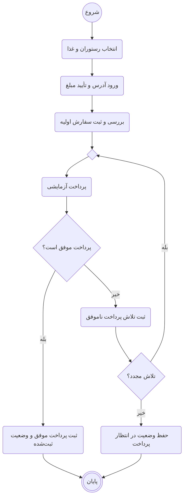
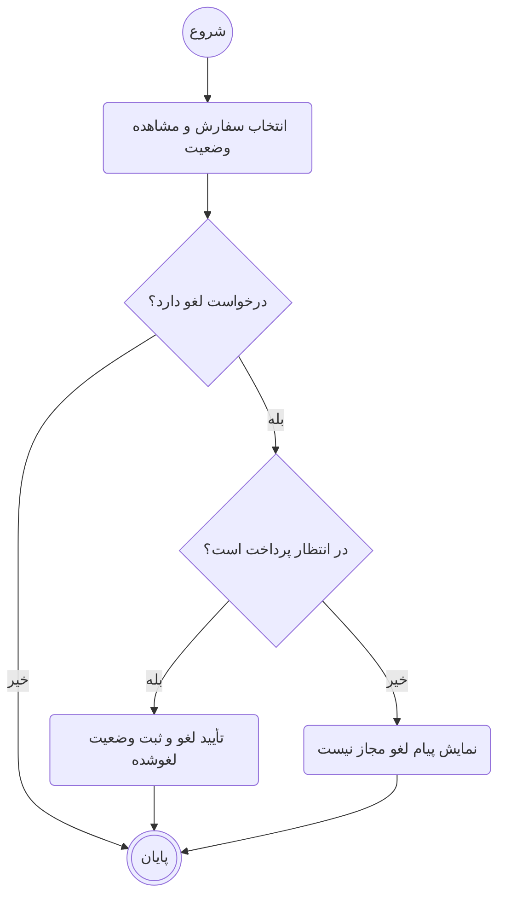
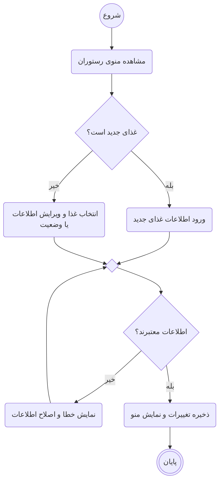
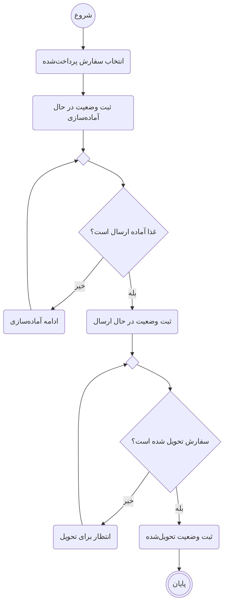

# نمودارهای فعالیت سامانه سفارش غذا

این نمودارها بر اساس [سند نیازمندی‌ها](../../srs/SRS.md) و سه نقش مشتری، مسئول رستوران و مدیر سیستم طراحی شده‌اند. هر نمودار یک فرایند اصلی را نشان می‌دهد و جزئیات فنی پیاده‌سازی در آن وارد نشده است.

در نمودارها، مستطیل‌های گوشه‌گرد فعالیت، لوزی دارای پرسش تصمیم و لوزی خالی محل ادغام مسیرهاست. دایره شروع و دایره دوتایی پایان فرایند را نشان می‌دهند.

| شناسه | فرایند | نقش اصلی | نیازمندی مرتبط |
|---|---|---|---|
| AD-01 | ثبت سفارش و پرداخت | مشتری و سامانه | FR-02 تا FR-07 |
| AD-02 | پیگیری و لغو سفارش | مشتری و سامانه | FR-08 |
| AD-03 | افزودن و ویرایش غذا | مسئول رستوران و سامانه | FR-09 |
| AD-04 | آماده‌سازی و تحویل سفارش | مسئول رستوران | FR-10 |

## AD-01 ثبت سفارش و پرداخت

پیش‌شرط: مشتری وارد حساب خود شده است. بررسی اولیه شامل سبد، تعداد، موجود بودن غذاها و اطلاعات تحویل است. مبلغ نهایی باید پیش از ثبت اولیه تأیید شود.

پرداخت ناموفق سفارش را لغو نمی‌کند؛ سفارش برای پرداخت مجدد یا لغو بعدی در وضعیت «در انتظار پرداخت» باقی می‌ماند.

## AD-02 پیگیری و لغو سفارش

پیش‌شرط: مشتری وارد حساب شده و سفارش متعلق به اوست.

لغو فقط پیش از پرداخت موفق مجاز است. این نمودار فرایند بازپرداخت ندارد.

## AD-03 افزودن و ویرایش غذا

پیش‌شرط: مسئول رستوران وارد پنل خود شده است. اطلاعات غذا شامل نام، توضیح، قیمت و وضعیت موجود بودن است؛ غیرفعال کردن غذا نیز از مسیر ویرایش انجام می‌شود.

غذایی که در سفارش‌های قبلی استفاده شده است، به جای حذف فیزیکی غیرفعال می‌شود.

## AD-04 آماده‌سازی و تحویل سفارش

پیش‌شرط: سفارش پرداخت موفق دارد و در وضعیت «ثبت‌شده» قرار گرفته است. مسئول رستوران فقط سفارش‌های رستوران خود را مدیریت می‌کند.

مسئول رستوران وضعیت ارسال و تحویل را ثبت می‌کند و حساب مستقل پیک وجود ندارد.

این نمودارها فقط فرایندهای انتخاب‌شده را پوشش می‌دهند. ثبت‌نام، مدیریت حساب‌ها و گزارش مدیر سیستم طبق SRS باقی می‌مانند، اما در این مجموعه نمودار جداگانه ندارند.
