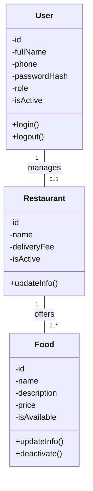
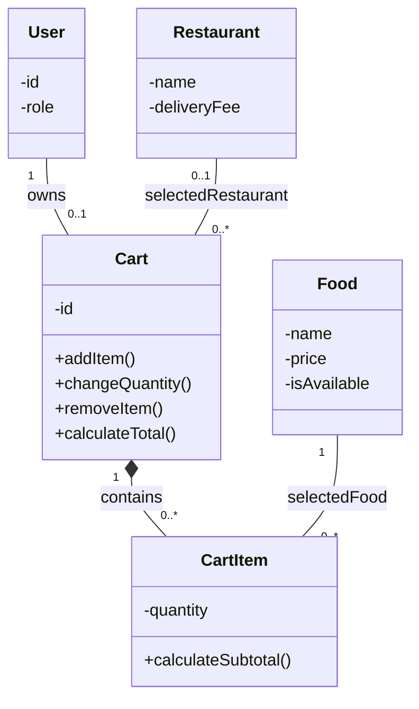
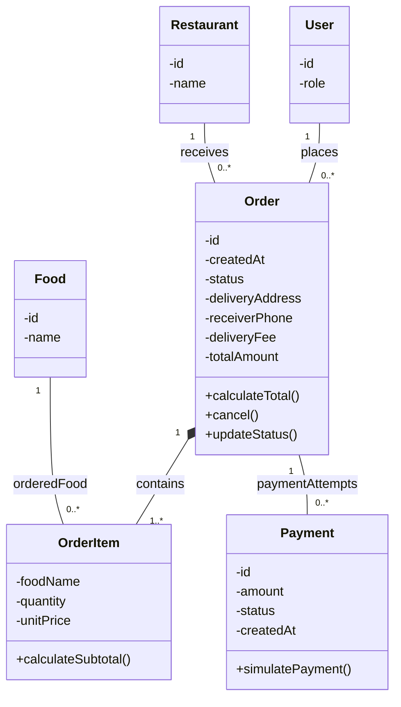

# نمودارهای کلاس سامانه سفارش غذا

سطح مفهومی برای پروژه متوسط دانشجویی

مبنای طراحی: نسخه ۲ سند SRS دانشجویی. این مجموعه سه نمای مرتبط از یک مدل واحد است؛ کلاس‌هایی با نام یکسان، در همه نمودارها همان کلاس هستند. برای خوانایی، در هر نما فقط ویژگی‌ها و رفتارهای مرتبط نشان داده شده‌اند. مشخصات دقیق ستون‌ها و نوع داده‌ها در مرحله طراحی SQL تکمیل می‌شوند.

| شناسه | نما | نیازمندی‌های مرتبط |
|---|---|---|
| CD-01 | کاربران، رستوران و منو | FR-01، FR-02، FR-09، FR-11 |
| CD-02 | سبد خرید و اقلام آن | FR-03 تا FR-05 |
| CD-03 | سفارش، اقلام سفارش و پرداخت | FR-06 تا FR-08، FR-10، FR-12 |

## راهنمای نام کلاس‌ها

| نام کلاس | مفهوم |
|---|---|
| User | حساب کاربری با نقش مشتری، مسئول رستوران یا مدیر سیستم |
| Restaurant | رستوران |
| Food | غذای منو |
| Cart | سبد خرید جاری مشتری |
| CartItem | یک غذای انتخاب‌شده و تعداد آن در سبد |
| Order | سفارش ثبت‌شده |
| OrderItem | یک قلم سفارش با نام و قیمت ثبت‌شده هنگام سفارش |
| Payment | یک تلاش پرداخت آزمایشی |

## راهنمای رابطه‌ها

- 1 یعنی دقیقاً یک، 0..1 یعنی صفر یا یک، 0..* یعنی صفر یا بیشتر و 1..* یعنی دست‌کم یک.
- لوزی توپر کنار Cart و Order رابطه جزء و کل را نشان می‌دهد: اقلام سبد و اقلام سفارش متعلق به همان سبد یا سفارش‌اند.
- علامت - ویژگی‌های داخلی و علامت + عملیات عمومی کلاس را نشان می‌دهد.
- مقادیر role عبارت‌اند از Customer، RestaurantManager و Admin؛ هر حساب یک نقش دارد.
- تمام مبلغ‌ها با واحد تومان در نظر گرفته می‌شوند.

## CD-01 کاربران، رستوران و منو

سه نقش مشتری، مسئول رستوران و مدیر سیستم با ویژگی role در کلاس User مشخص می‌شوند. برای ساده‌سازی، هر رستوران یک حساب مسئول دارد و هر حساب مسئول حداکثر یک رستوران را مدیریت می‌کند.

- رابطه manages فقط برای کاربری با نقش مسئول رستوران برقرار می‌شود؛ مشتری و مدیر سیستم از این رابطه استفاده نمی‌کنند.
- مدیر سیستم با نقش Admin اجازه مدیریت حساب‌ها و رستوران‌ها و مشاهده گزارش‌ها را دارد؛ این دسترسی به معنی مسئول بودن آن رستوران نیست.
- غذای دارای سابقه سفارش غیرفعال می‌شود تا اطلاعات سفارش‌های قبلی حفظ شود.

## CD-02 سبد خرید و اقلام آن

مشتری می‌تواند حداکثر یک سبد جاری داشته باشد. سبد خالی هنوز رستوران مشخصی ندارد؛ با افزودن اولین غذا، رستوران آن مشخص می‌شود.

- رابطه owns فقط برای کاربر با نقش مشتری است.
- همه غذاهای یک سبد باید از همان رستوران باشند. انتخاب رستوران دیگر به تأیید مشتری برای جایگزینی سبد قبلی نیاز دارد.
- تعداد هر قلم مثبت است. قیمت فعلی غذا و هزینه ثابت ارسال در محاسبه مبلغ سبد استفاده می‌شوند؛ مبلغ نهایی هنگام ثبت سفارش دوباره بررسی و تأیید می‌شود.

## CD-03 سفارش، اقلام سفارش و پرداخت

هر سفارش به یک مشتری و یک رستوران تعلق دارد و دست‌کم یک قلم غذا دارد. در این نمودار، هر شیء Payment نماینده یک تلاش پرداخت آزمایشی است.

- رابطه places فقط برای کاربر با نقش مشتری است.
- foodName و unitPrice در OrderItem، نام و قیمت غذا هنگام ثبت سفارش را نگه می‌دارند. متن آدرس و هزینه ارسال نیز در خود Order ثبت می‌شوند تا تغییرات بعدی، سابقه سفارش را تغییر ندهند.
- پس از ثبت اولیه، اقلام و مبلغ سفارش تغییر نمی‌کنند؛ مشتری پیش از پرداخت می‌تواند سفارش را لغو و سفارش تازه‌ای ثبت کند.
- هر سفارش ممکن است چند تلاش پرداخت داشته باشد، اما حداکثر یکی از آن‌ها موفق است. پرداخت ناموفق، سفارش را در انتظار پرداخت نگه می‌دارد.
- لغو فقط پیش از پرداخت موفق مجاز است. مسئول رستوران وضعیت سفارش پرداخت‌شده را به ترتیب به آماده‌سازی، ارسال و تحویل‌شده تغییر می‌دهد.

## وضعیت‌های اصلی

- سفارش: در انتظار پرداخت، ثبت‌شده، در حال آماده‌سازی، در حال ارسال، تحویل‌شده و لغوشده.
- تلاش پرداخت: در انتظار نتیجه، موفق یا ناموفق. هر تلاش، نتیجه جداگانه دارد.

در این مدل، ثبت وضعیت ارسال و تحویل در پنل رستوران انجام می‌شود. حساب مستقل پیک، درگاه بانکی واقعی و بازپرداخت در دامنه نسخه دانشجویی قرار ندارند.

