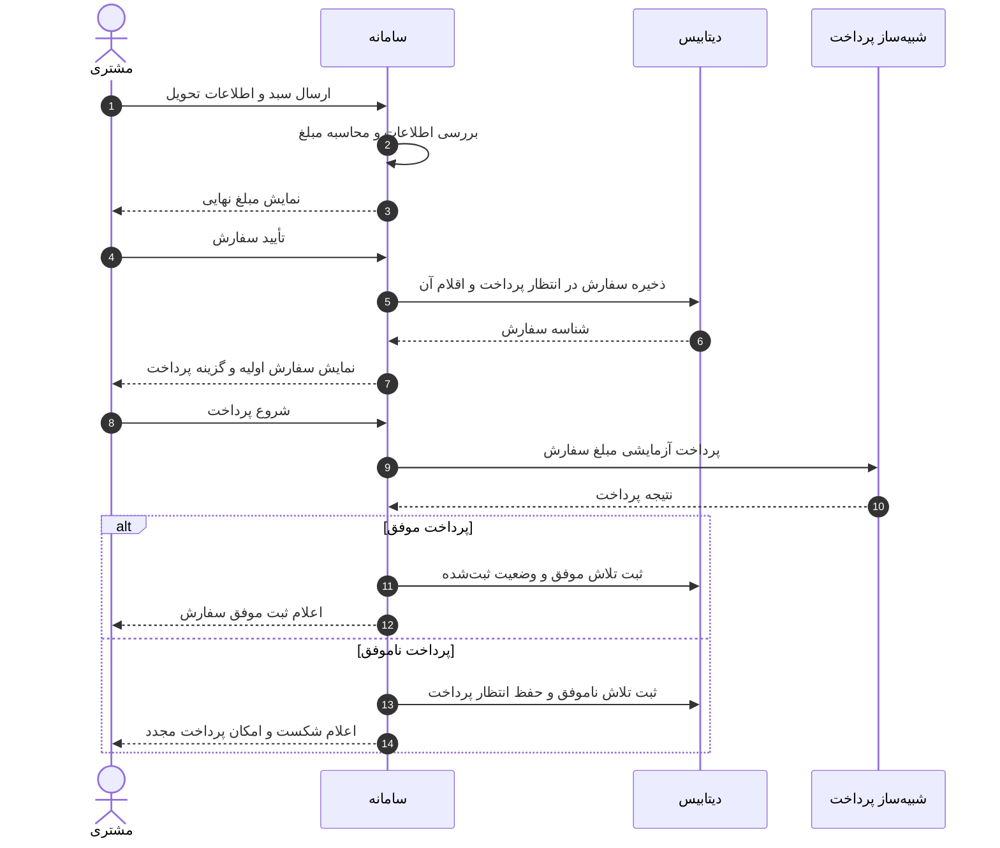
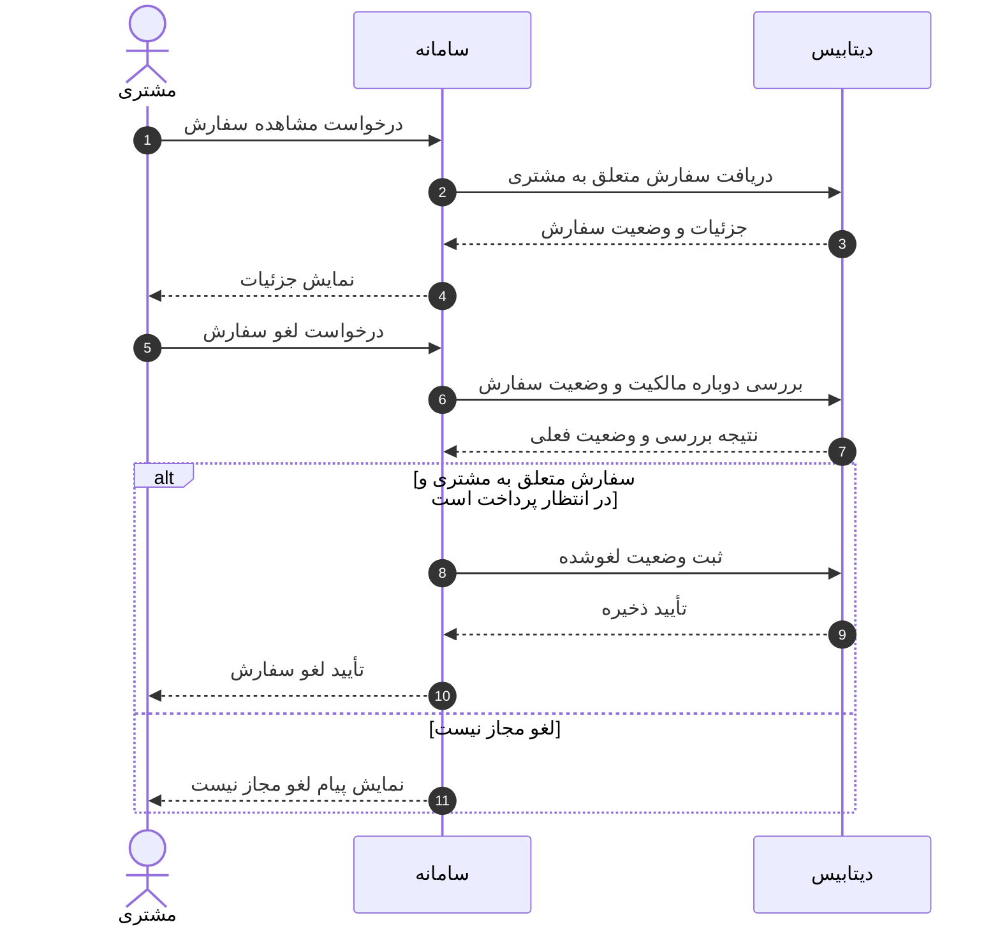
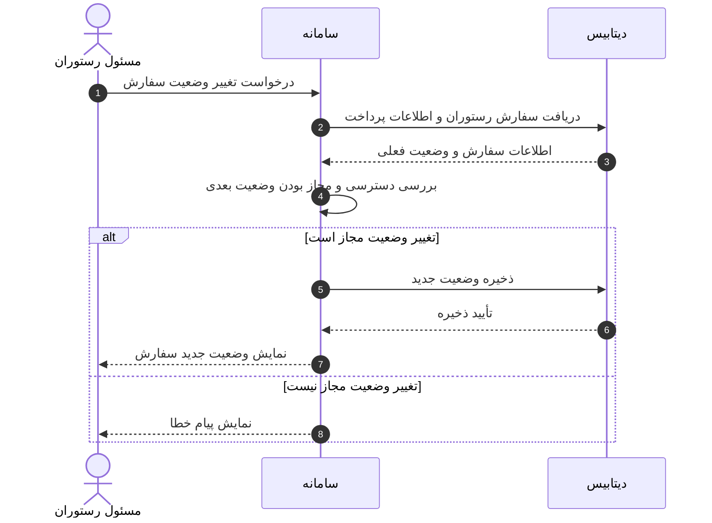

# نمودارهای توالی سامانه سفارش غذا

این سه نمودار، توالی تعامل‌های اصلی سامانه را بر اساس [سند نیازمندی‌ها](../../srs/SRS.md) نشان می‌دهند.

در این مدل، سامانه یک بخش واحد است و جزئیات رابط کاربری، API و لایه‌های داخلی وارد نمودار نشده‌اند. دیتابیس محل نگهداری اطلاعات است و شبیه‌ساز پرداخت، نتیجه آزمایشی موفق یا ناموفق ایجاد می‌کند.

| شناسه | سناریو | نیازمندی مرتبط |
|---|---|---|
| SD-01 | ثبت سفارش و پرداخت آزمایشی | FR-04 تا FR-07 |
| SD-02 | پیگیری و لغو سفارش | FR-08 |
| SD-03 | تغییر وضعیت سفارش توسط رستوران | FR-10 |

## راهنمای خواندن

- پیام‌ها از بالا به پایین دنبال می‌شوند و شماره‌ها ترتیب آن‌ها را نشان می‌دهند.
- خط پیوسته درخواست یا اقدام و خط‌چین پاسخ را نشان می‌دهد.
- کادر alt مسیرهای جایگزین را بر اساس شرط نمایش می‌دهد.
- پیام سامانه به خودش، یک فعالیت داخلی مانند محاسبه مبلغ یا بررسی مجوز است.
- جزئیات همه خطاهای ورودی در این نماهای مفهومی رسم نشده‌اند؛ قواعد SRS همچنان برقرارند.

## SD-01 ثبت سفارش و پرداخت آزمایشی

پیش‌شرط: مشتری وارد حساب شده و غذاهای یک رستوران را انتخاب کرده است. برای ساده ماندن نمودار، بررسی سبد، موجود بودن غذاها و قیمت‌ها در یک فعالیت سامانه نشان داده شده‌اند.

- سفارش اولیه پیش از پرداخت ساخته می‌شود. پس از تأیید مبلغ، اقلام و مبلغ همان سفارش ثابت می‌مانند.
- هر تلاش پرداخت ثبت می‌شود و حداکثر یک تلاش موفق برای سفارش مجاز است. سفارش لغوشده یا دارای پرداخت موفق دوباره قابل پرداخت نیست.
- نمایش موفقیت به مشتری پس از ذخیره موفق اطلاعات انجام می‌شود. برای خوانایی، پاسخ تأیید ذخیره در شاخه‌های پرداخت رسم نشده است.

## SD-02 پیگیری و لغو سفارش

پیش‌شرط: مشتری وارد حساب خود شده است. فقط اطلاعات سفارش متعلق به همان مشتری قابل مشاهده و تغییر است.

- لغو فقط در وضعیت «در انتظار پرداخت» مجاز است؛ پس از پرداخت موفق، لغو مجاز نیست.
- بررسی مجدد هنگام درخواست لغو اهمیت دارد؛ وضعیت سفارش ممکن است از زمان مشاهده جزئیات تغییر کرده باشد.
- این نمودار مسیر درخواست لغو پس از مشاهده سفارش را نشان می‌دهد. مشاهده سفارش بدون درخواست لغو، پس از نمایش جزئیات پایان می‌یابد.

## SD-03 تغییر وضعیت سفارش توسط رستوران

پیش‌شرط: مسئول رستوران وارد پنل شده و یک سفارش را برای تغییر وضعیت انتخاب کرده است. سامانه مالکیت سفارش، پرداخت موفق و مجاز بودن مرحله بعد را بررسی می‌کند.

- این تعامل برای رفتن از «ثبت‌شده» به «در حال آماده‌سازی»، سپس «در حال ارسال» و در پایان «تحویل‌شده» تکرار می‌شود.
- ثبت مراحل ارسال و تحویل توسط مسئول رستوران انجام می‌شود و حساب مستقل پیک وجود ندارد.
- سفارش پرداخت‌نشده، سفارش رستوران دیگر و انتقال خارج از ترتیب تعریف‌شده نباید تغییر وضعیت مجاز دریافت کنند.
