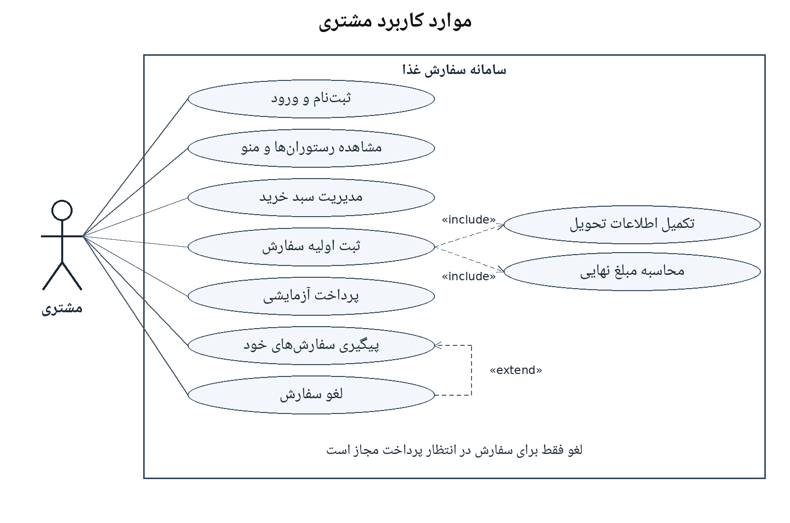
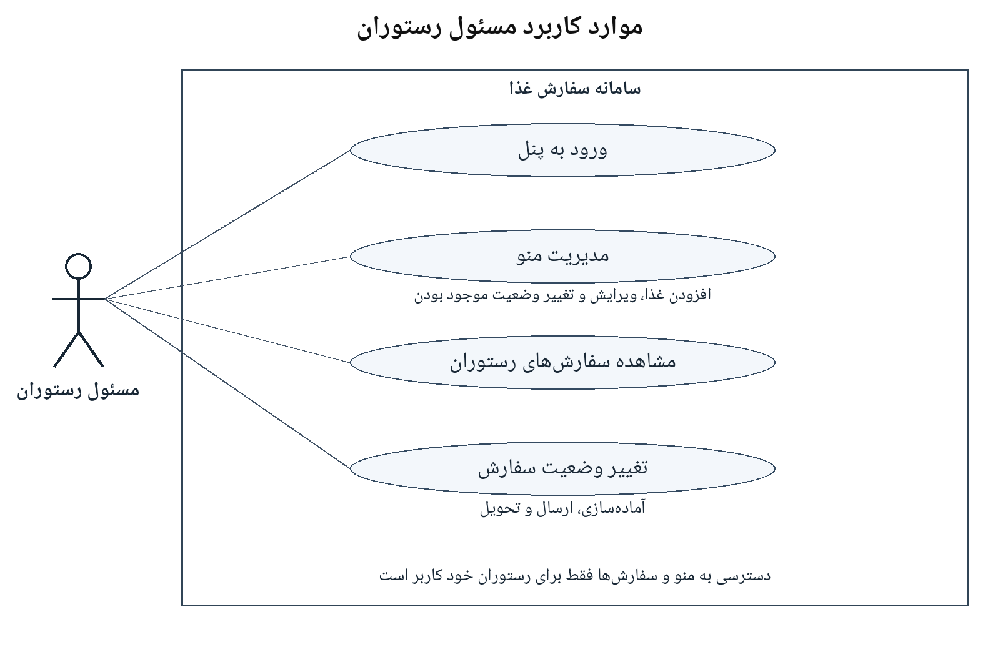
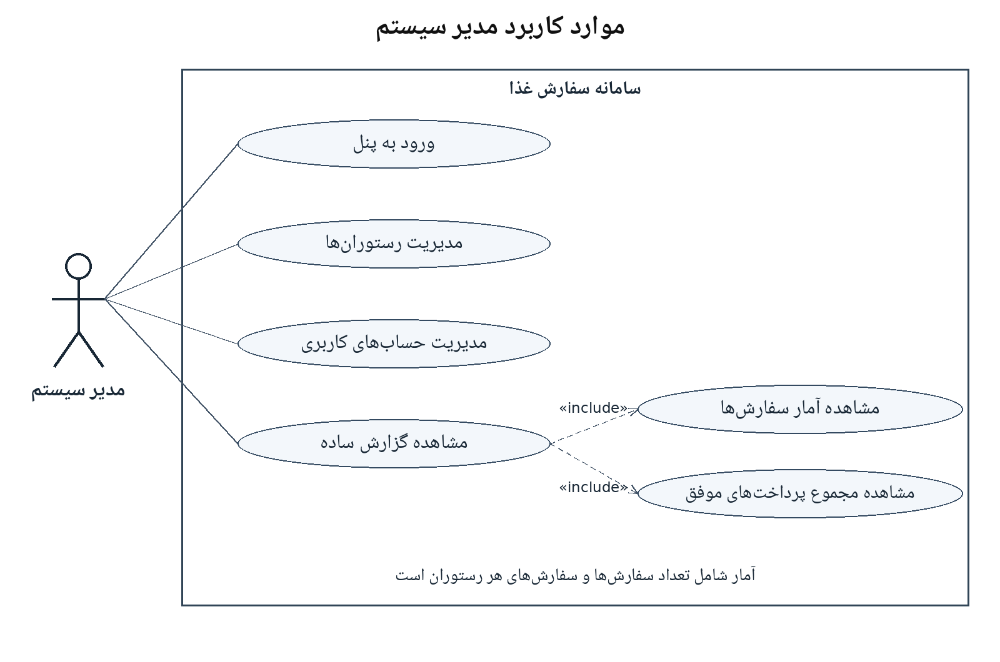

# نمودارهای موارد کاربرد سامانه سفارش غذا

این سه نما، قابلیت‌های سامانه را برای نقش‌های اصلی بر اساس [سند نیازمندی‌ها](../../srs/SRS.md) نشان می‌دهند.

## راهنمای نمادها

- آدمک، بازیگر بیرونی سامانه است و بیضی، یک قابلیت یا مورد کاربرد را نشان می‌دهد.
- کادر، مرز سامانه سفارش غذاست.
- خط پیوسته ارتباط بازیگر با قابلیت را نشان می‌دهد و ترتیب انجام کارها را مشخص نمی‌کند.
- include یعنی اجرای قابلیت اصلی، قابلیت مقصد را نیز به عنوان بخشی الزامی در بر می‌گیرد.
- extend یعنی قابلیت مبدأ در شرایط مشخص، رفتار اختیاری به قابلیت مقصد اضافه می‌کند.

## نمای مشتری

ثبت‌نام و ورود در یک مورد کاربرد مفهومی گروه‌بندی شده‌اند. مشاهده منو بدون ورود مجاز است؛ ثبت سفارش، پرداخت، پیگیری و لغو به ورود مشتری نیاز دارند. ورود، پیش‌شرط عملیات است و رابطه include برای همه عملیات به ورود رسم نشده است.

ثبت اولیه سفارش شامل تکمیل اطلاعات تحویل و محاسبه مبلغ است. بررسی غذاها و تأیید مبلغ در شرح همین فرایند انجام می‌شوند. پرداخت آزمایشی یک مورد کاربرد جداست، چون سفارش اولیه پیش از پرداخت ساخته می‌شود.

لغو، رفتار اختیاری هنگام پیگیری سفارش است و فقط برای سفارش در انتظار پرداخت مجاز است. پرداخت ناموفق نیز سفارش را در همین وضعیت نگه می‌دارد. این نما با FR-01 تا FR-08 مرتبط است.

## نمای مسئول رستوران

مدیریت منو شامل افزودن غذا، ویرایش اطلاعات و تغییر موجود بودن یا غیرفعال کردن غذاست. مسئول فقط به منو و سفارش‌های رستوران خود دسترسی دارد. تغییر وضعیت سفارش، آماده‌سازی، ارسال و تحویل را به ترتیب پوشش می‌دهد. فقط سفارش‌های پرداخت‌شده برای این فرایند ارائه می‌شوند. این نما با FR-09 و FR-10 مرتبط است.

## نمای مدیر سیستم

مدیریت رستوران‌ها، ایجاد، ویرایش و فعال یا غیرفعال کردن رستوران را پوشش می‌دهد. مدیریت حساب‌ها، ایجاد حساب مسئول رستوران و تغییر وضعیت حساب کاربران را در بر می‌گیرد. ثبت‌نام عمومی مخصوص مشتری است.

گزارش ساده شامل آمار سفارش‌ها، تعداد سفارش‌های هر رستوران و مجموع مبالغ پرداخت‌های موفق آزمایشی است. این نما با FR-11 و FR-12 مرتبط است.

در این نسخه حساب مستقل پیک، پرداخت بانکی واقعی و بازپرداخت وجود ندارند.
